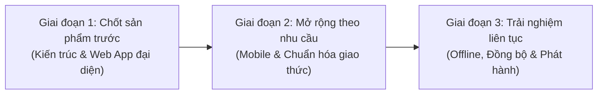
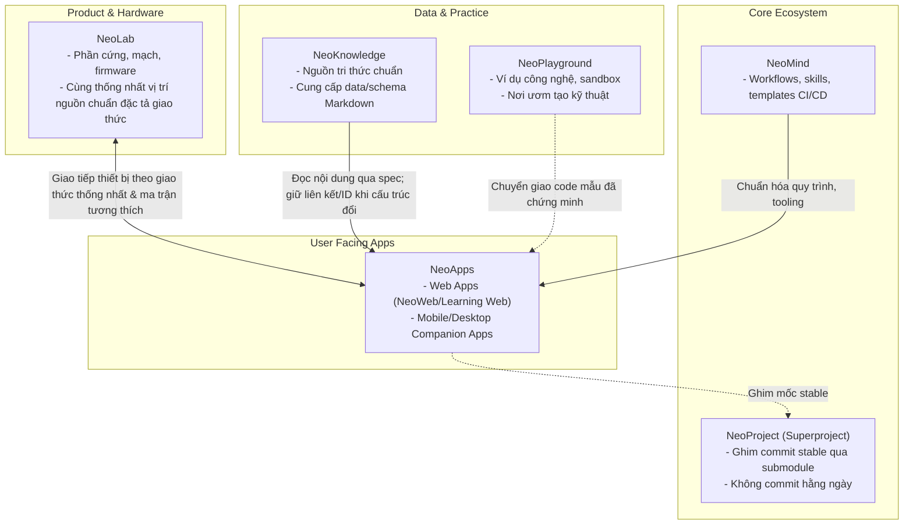

# Repo Plan — NeoApps

Tài liệu này xác định mục tiêu, hiện trạng thực tế, đề xuất cấu trúc tổ chức, lộ trình phát triển và các quyết định kiến trúc còn mở cho kho mã nguồn **NeoApps** thuộc hệ sinh thái **NeoProject v2**.

> [!IMPORTANT]
> **Lưu ý về các đề xuất kỹ thuật:** Các phương án về cấu trúc Monorepo, kiến trúc dữ liệu Local-first, công cụ quản lý gói (pnpm, Turborepo...) và lựa chọn công nghệ (Tech Stack) nêu trong tài liệu này hoàn toàn là các phương án đề xuất kỹ thuật nhằm mục đích khảo sát và định hướng thảo luận; **chưa phải là quyết định đã được chủ dự án phê duyệt chính thức**.

---

## 1. Mục tiêu và phạm vi

### 1.1. Mục tiêu
**NeoApps** giữ vai trò là repository đầu mối (entry repository / portfolio) cho toàn bộ các ứng dụng phía người dùng trong hệ sinh thái Neo, bao gồm các ứng dụng Web, Di động (Android / iOS) và Desktop (nếu có sau này).

Mục tiêu cốt lõi của NeoApps:
* Là nơi quản lý, phát triển và tích hợp các sản phẩm phần mềm tương tác trực tiếp với người học, người dùng cuối và thiết bị phần cứng.
* Cung cấp trải nghiệm người dùng đồng nhất, kết nối mạch lạc giữa việc học lý thuyết, thực hành ứng dụng và điều khiển thiết bị phần cứng thực tế.
* Đảm bảo tính độc lập về chu kỳ phát triển (development lifecycle) và phát hành (release lifecycle) của từng ứng dụng, không bị phụ thuộc cứng vào tần suất phát hành của các thành phần khác.

### 1.2. Danh mục ứng dụng tiềm năng trong hệ sinh thái
Dựa trên thiết kế kiến trúc hệ sinh thái Neo:
1. **NeoWeb (Phạm vi chưa chốt):** Repo đã tồn tại (`NeoTech-vietnam/NeoWeb`, Public). Theo Canvas, phạm vi xuất bản và vai trò ứng dụng của NeoWeb hiện chưa được xác nhận, đang được xem xét theo các giả định / phương án:
   * *Giả định A:* NeoWeb là cổng thông tin web chính (public portal / website giới thiệu / blog dự án).
   * *Giả định B:* NeoWeb là ứng dụng học tập tương tác (hoặc tích hợp phân hệ học tập trực tiếp vào NeoWeb).
   * *Giả định C:* NeoWeb và Learning Web là hai ứng dụng hoàn toàn tách biệt.
2. **Learning Web (Ứng dụng học tập):** Ứng dụng web tương tác hỗ trợ duyệt cây tri thức, đọc bài học, ghi chú, biên soạn nội dung và theo dõi tiến độ học tập (có thể độc lập hoặc hợp nhất với NeoWeb tùy quyết định).
3. **Ứng dụng đồng hành NeoAssistant (Companion App):** Ứng dụng trên di động/desktop kết nối, cấu hình và tương tác với thiết bị thông minh NeoAssistant (hiện là concept trong hệ sinh thái).
4. **NeoWatchApp:** Ứng dụng đồng hành hoặc ứng dụng cài đặt cho thiết bị đồng hồ thông minh NeoWatch (hiện tại repo riêng `NeoTech-vietnam/NeoWatchApp`, Private).
5. **Các tiện ích và công cụ UI bổ trợ:** Bộ công cụ dùng chung, tài nguyên thiết kế UI, client API và bộ kịch bản kiểm thử tích hợp giao diện người dùng.

### 1.3. Ranh giới và phạm vi phân định (Boundaries)
* **Với NeoKnowledge:** Ứng dụng trong NeoApps chỉ đọc và hiển thị nội dung kiến thức qua giao diện, cấu hình hoặc định dạng dữ liệu chuẩn (Markdown/JSON). NeoApps **tuyệt đối không** duy trì bản sao nội dung độc lập nhằm tránh tình trạng lệch dữ liệu (content drift). Khi cấu trúc nội dung thay đổi, ứng dụng cần giữ liên kết hiện tại và chỉ bổ sung hệ thống ID khi cần thiết để bảo toàn tham chiếu, không bắt buộc phải áp đặt ngay hệ thống persistent ID phức tạp ban đầu.
* **Với NeoLab:** NeoLab phụ trách toàn bộ thiết kế phần cứng, sơ đồ mạch, linh kiện và firmware nhúng. NeoApps **chỉ** đóng vai trò là phần mềm ứng dụng giao tiếp/điều khiển (companion software) thông qua giao thức được thống nhất và bảng ma trận tương thích phiên bản. **Vị trí đặt nguồn chuẩn của đặc tả giao thức** hiện chưa chốt cứng ở repo nào; hai bên (NeoApps và NeoLab) phải cùng thảo luận để thống nhất vị trí nguồn chuẩn (đặt tại NeoLab, NeoApps hoặc tài liệu đặc tả chung). Firmware tuyệt đối không đặt trong NeoApps.
* **Với NeoMind:** NeoApps tuân thủ các quy chuẩn phát triển, quy trình làm việc (workflows) và bộ kỹ năng (skills/templates) do NeoMind chuẩn hóa.
* **Với NeoPlayground:** NeoPlayground là không gian thử nghiệm, học tập kỹ thuật và chứa các ví dụ công nghệ độc lập. Các mẫu thử nghiệm chỉ được đưa vào NeoApps khi đã chứng minh được tính khả thi và được chuẩn hóa thành tính năng sản phẩm.
* **Với NeoProject:** NeoApps phát triển độc lập trên các branch riêng. Siêu dự án NeoProject chỉ đóng vai trò ghi nhận (snapshot) con trỏ commit ổn định (stable pointer) qua Git submodule, không can thiệp vào mã nguồn hàng ngày.

---

## 2. Hiện trạng thực tế

Hiện trạng của repository NeoApps được ghi nhận thực tế tại workspace như sau:

* **Trạng thái Git Repository:**
  * Remote URL: `git@github.com:NeoTech-vietnam/NeoApps.git` (Giao thức SSH; trạng thái Public).
  * Branch mặc định trên remote: `main`.
  * Branch làm việc phục vụ lập kế hoạch trong worktree hiện tại: `docs/repo-plan`.
  * Commit khởi tạo hiện tại: `c82f47d88aba39d989a69e3dc38bce121ffccd30` (Thông điệp: `Initial commit`).
* **Cấu trúc tệp hiện có trong repository:**
  * Duy nhất 01 tệp: [`README.md`](file:///H:/Learning/Neo/NeoProject_worktrees/grand-dove/NeoApps/README.md) (kích thước 2 dòng văn bản).
  * Nội dung hiện tại của README.md:
    ```markdown
    # NeoApps
    Applications portfolio for the Neo ecosystem, covering web and mobile applications. Component repository relationships and source layout will be defined as projects evolve.
    ```
* **Quan sát thực tế bổ sung:**
  * Chưa có mã nguồn ứng dụng, cấu hình build system, package manager hay framework nào được khởi tạo.
  * Chưa cấu hình backend hay bất kỳ API service nào.
  * Chưa có tài liệu thiết kế hoặc kiểm thử tự động.
  * Chưa thực hiện bất kỳ thao tác di chuyển (migration) hay tích hợp nào từ các repository ứng dụng hiện có trước đây của tổ chức (như `NeoWeb` hay `NeoWatchApp`).

---

## 3. Cấu trúc thư mục sắp tới được đề xuất (Phương án tham khảo)

Quan hệ giữa repository đầu mối NeoApps và các ứng dụng thành phần vẫn là câu hỏi mở cần quyết định. Dưới đây là phân tích các phương án khả dĩ và đề xuất cấu trúc tham khảo.

### 3.1. Các phương án kiến trúc repository

* **Phương án 1: Monorepo theo Ứng dụng (App-centric Monorepo — Đề xuất tham khảo):**
  * NeoApps quản lý các ứng dụng (web, mobile companion) và các thư viện dùng chung (`packages/*`) trong cùng một kho lưu trữ bằng công cụ quản lý workspace (như pnpm workspaces / Turborepo / Nx).
  * *Ưu điểm:* Dễ dàng chia sẻ UI components, type definitions và API schemas giữa Web và Mobile; bảo đảm tính nhất quán khi cập nhật giao thức kết nối thiết bị.
  * *Nhược điểm:* Cần thiết lập tooling quản lý monorepo chặt chẽ; cần sự đồng thuận của chủ dự án về hạ tầng monorepo.

* **Phương án 2: Tổ chức theo Nền tảng (Platform-centric):**
  * Chia mã nguồn theo thư mục nền tảng: `web/`, `mobile/android`, `mobile/ios`, `desktop/`.
  * *Ưu điểm:* Phù hợp nếu mỗi nền tảng do một nhóm độc lập phát triển.
  * *Nhược điểm:* Dễ dẫn đến phân mảnh logic nghiệp vụ và khó tái sử dụng mã nguồn dùng chung giữa các nền tảng cùng hướng đến một sản phẩm.

* **Phương án 3: Umbrella/Catalog Repository:**
  * NeoApps chỉ lưu trữ tài liệu đặc tả, UI design tokens, dashboard liên kết và cấu hình tích hợp, trong khi mỗi ứng dụng (`NeoWeb`, `LearningWeb`, `NeoWatchApp`...) tiếp tục nằm ở một repo riêng biệt.
  * *Nhược điểm:* Tăng số lượng repo cần quản lý độc lập, khó đồng bộ phiên bản giao tiếp dùng chung.

### 3.2. Cấu trúc thư mục đề xuất tham khảo (Mô hình App-centric Monorepo — Chưa phê duyệt)

```text
NeoApps/
├── docs/                           # Tài liệu kiến trúc, ADR và hướng dẫn phát triển
│   ├── Repo Plan.md                # Kế hoạch phát triển tổng thể repo
│   ├── architecture/               # Sơ đồ và quyết định kiến trúc (ADRs)
│   └── protocols/                  # Bảng tương thích phiên bản và đặc tả giao thức (thống nhất với NeoLab)
├── apps/                           # Các ứng dụng thành phần độc lập (đề xuất tham khảo)
│   ├── web/                        # NeoWeb — Theo phạm vi được chốt (portal hoặc web app học tập)
│   ├── learning-web/               # Learning Web — Ứng dụng web học tập (nếu tách riêng với NeoWeb)
│   ├── companion-assistant/        # Ứng dụng di động/desktop đồng hành với NeoAssistant (concept)
│   └── watch-companion/            # Ứng dụng đồng hành cho NeoWatch (nếu chốt tích hợp từ NeoWatchApp)
├── packages/                       # Các gói và thư viện dùng chung nội bộ (đề xuất tham khảo)
│   ├── ui-kit/                     # Hệ thống Design System, UI components
│   ├── api-client/                 # Client giao tiếp với backend dịch vụ và schema dữ liệu
│   ├── device-protocol/            # Thư viện giao tiếp Bluetooth/Serial (theo vị trí nguồn chuẩn được thống nhất)
│   └── shared-types/               # Khai báo TypeScript types, interfaces và data models chung
├── backend/                        # (Đề xuất có điều kiện) Dịch vụ backend/API nếu có nhu cầu
│   └── ...                         # Sẽ quyết định cụ thể theo mô hình backend được duyệt
├── tests/                          # Kiểm thử tích hợp tổng thể (E2E, cross-app flows)
├── .github/                        # Workflows CI/CD độc lập cho từng ứng dụng
├── README.md                       # Tài liệu tổng quan và hướng dẫn khởi chạy nhanh
└── package.json / pnpm-workspace.yaml # Cấu hình workspace monorepo (đề xuất tham khảo)
```

### 3.3. Trách nhiệm thư mục và nguồn chuẩn (Canonical Sources)

| Thư mục / Thành phần | Trách nhiệm chính | Nguồn chuẩn (Canonical Source) |
| :--- | :--- | :--- |
| `docs/` | Lưu trữ tài liệu quy chuẩn, quyết định kỹ thuật và ma trận tương thích | Trực tiếp tại `NeoApps/docs/` |
| `apps/learning-web` | Giao diện trải nghiệm người học, kết nối bài học | Nội dung bài học lấy chuẩn từ `NeoKnowledge` |
| `apps/companion-*` | Ứng dụng giao tiếp, điều khiển thiết bị phần cứng | Đặc tả phần cứng/firmware thuộc `NeoLab`; đặc tả giao thức theo vị trí nguồn chuẩn được thống nhất |
| `packages/device-protocol` | Mã hóa/giải mã frame truyền thông phần cứng | **Chưa chốt vị trí nguồn chuẩn:** Cần hai bên (NeoApps và NeoLab) cùng thống nhất nơi đặt đặc tả chuẩn |
| `packages/ui-kit` | Đồng nhất giao diện, màu sắc, typography của thương hiệu | Design token và asset chuẩn hóa nội bộ Neo |
| CI/CD & Linter Config | Tự động hóa kiểm tra mã nguồn và quy trình release | Tuân theo templates & workflows chuẩn từ `NeoMind` |

---

## 4. Lộ trình phát triển

Lộ trình phát triển của NeoApps được chia làm 3 giai đoạn rõ ràng, bám sát định hướng từ canvas kiến trúc:



### 4.1. Giai đoạn đầu · Chốt sản phẩm trước (Prioritize Product & Architecture Baseline)
* **Nội dung trọng tâm:**
  1. Thống nhất mối quan hệ giữa **Learning Web** và **NeoWeb**: Làm rõ phạm vi của NeoWeb (portal xuất bản hay web app học tập), quyết định xem đây là hai ứng dụng tách biệt hay cùng thuộc một hệ thống.
  2. Chọn **một trải nghiệm ưu tiên** để triển khai nguyên mẫu (khuyến nghị ưu tiên nền tảng Web: ứng dụng duyệt bài học kết nối kho tri thức).
  3. Cấu hình rõ ràng cơ chế tiêu thụ nguồn nội dung (đọc từ định dạng Markdown/JSON của `NeoKnowledge`) và cơ chế lưu trữ tiến độ học tập (phương án đề xuất tham khảo: Local-first qua Web Storage / IndexedDB hoặc phương án khác tùy phê duyệt).
  4. Xác định rõ ràng vị trí đặt backend: Nằm trực tiếp trong `NeoApps/backend`, sử dụng dịch vụ quản lý ngoài (BaaS/Serverless), hay tách thành repo backend riêng biệt.
* **Đầu ra (Deliverables):**
  * Bản đặc tả kiến trúc ứng dụng và mô hình dữ liệu người học.
  * 01 ứng dụng Web nguyên mẫu chạy độc lập, kết nối thành công với dữ liệu mẫu từ `NeoKnowledge`.
* **Tiêu chí hoàn thành (Exit Criteria):**
  * Ứng dụng chạy mượt mà trên môi trường local, hiển thị chính xác bài học mẫu từ `NeoKnowledge` mà không gây lỗi hoặc thay đổi dữ liệu gốc.
  * Tiến độ bài học và cài đặt của người dùng được lưu trữ cục bộ thành công mà không phụ thuộc vào hạ tầng cloud phức tạp.

### 4.2. Giai đoạn mở rộng · Theo nhu cầu sử dụng (Expand by Demand)
* **Nội dung trọng tâm:**
  1. Bắt đầu phát triển ứng dụng di động (Android / iOS) khi phát sinh nhu cầu học tập trên điện thoại hoặc khi cần kết nối trực tiếp với thiết bị phần cứng từ `NeoLab` (thông qua Bluetooth Low Energy hoặc Wi-Fi).
  2. Thống nhất vị trí nguồn chuẩn đặc tả giao thức giữa NeoApps và NeoLab; thiết lập quy chuẩn đánh phiên bản (Semantic Versioning) nghiêm ngặt cho API, giao thức kết nối phần cứng và cấu trúc dữ liệu trao đổi.
  3. Xây dựng các bài kiểm thử tự động cho các luồng tương tác chính (User Journey) trên từng nền tảng tương ứng.
  4. Trích xuất các logic chung thành các package chia sẻ (`packages/ui-kit`, `packages/device-protocol`) khi đã có sự trùng lặp thực tế giữa Web và Mobile (tránh tối ưu hóa quá sớm).
* **Đầu ra (Deliverables):**
  * Bản dựng thử nghiệm (alpha/beta build) của ứng dụng di động.
  * Bộ thư viện chia sẻ `packages/*` hoạt động ổn định.
  * Ma trận tương thích phiên bản ứng dụng - firmware thiết bị.
* **Tiêu chí hoàn thành (Exit Criteria):**
  * Các luồng nghiệp vụ chính chạy thông suốt trên cả Web và thiết bị di động.
  * Giao tiếp giữa ứng dụng companion và firmware của `NeoLab` hoạt động chính xác theo đúng đặc tả giao thức đã thống nhất giữa hai repo.
  * Hệ thống CI tự động chạy kiểm thử thành công cho từng ứng dụng độc lập khi có pull request.

### 4.3. Giai đoạn dài hạn · Trải nghiệm liên tục (Seamless Long-term Experience)
* **Nội dung trọng tâm:**
  1. Hỗ trợ cơ chế làm việc ngoại tuyến (Offline-first) và đồng bộ hóa tiến độ, ghi chú khi người dùng sử dụng đồng thời nhiều thiết bị.
  2. Tích hợp liền mạch chu trình học tập: Học lý thuyết (NeoKnowledge) ➔ Thực hành lập trình/mô phỏng (NeoPlayground) ➔ Triển khai và điều khiển thiết bị thực tế (NeoLab).
  3. Tách biệt quy trình phát hành (Release pipelines): Web triển khai tự động (Continuous Deployment), Mobile phát hành qua các kênh phân phối ứng dụng (App Store, Google Play Store hoặc tệp cài đặt nội bộ).
  4. *Nguyên tắc kiềm chế kỹ thuật:* Không mặc định áp đặt một hệ thống tài khoản đám mây tập trung, không ép buộc một kiến trúc backend phức tạp, và không gượng ép một framework đa nền tảng duy nhất cho mọi bài toán nếu chưa có nhu cầu sử dụng thực tế kiểm chứng.
* **Đầu ra (Deliverables):**
  * Bộ sản phẩm ứng dụng hoàn chỉnh, hỗ trợ trải nghiệm người dùng xuyên suốt trên các nền tảng.
  * Quy trình phát hành tự động hóa hoàn toàn.
* **Tiêu chí hoàn thành (Exit Criteria):**
  * Trải nghiệm người dùng mượt mà, việc nâng cấp ứng dụng không bao giờ làm mất dữ liệu hay tiến độ đã lưu của người học.
  * Hệ thống hoạt động tin cậy trong điều kiện không có mạng Internet.

---

## 5. Phụ thuộc và ranh giới với các repo khác



* **Ma trận phụ thuộc và nguyên tắc làm việc:**
  * **Với NeoKnowledge:** Quan hệ tiêu thụ một chiều. NeoApps đọc dữ liệu theo định dạng chuẩn hoặc API. Khi NeoKnowledge sắp xếp lại thư mục, ứng dụng cần giữ liên kết hiện tại và chỉ bổ sung hệ thống ID khi cần thiết để không làm gãy đường dẫn bài học, không bắt buộc phải áp đặt ngay hệ thống persistent ID phức tạp ban đầu.
  * **Với NeoLab:** Quan hệ đối ứng hai chiều qua giao thức. Nguồn chuẩn của đặc tả giao thức (thuộc NeoLab, NeoApps hay tài liệu dùng chung) chưa chốt và cần được hai repo thống nhất. Mỗi thay đổi trong firmware (ví dụ phiên bản BLE GATT service) phải được phản ánh vào ma trận tương thích trong tài liệu giao thức.
  * **Với NeoMind:** Nhận quy chuẩn về linting, commit conventions, CI workflows và các bộ kỹ năng agent hỗ trợ phát triển.
  * **Với NeoProject:** Làm việc hoàn toàn độc lập trên branch của NeoApps (`docs/repo-plan`, `feature/*`, `main`). Chỉ khi đạt mốc release ổn định mới đề xuất NeoProject cập nhật con trỏ gitlink tương ứng.

---

## 6. Hiện trạng phân định và các quyết định còn mở

Bảng tổng hợp dưới đây phân định rõ ràng giữa những điểm **Đã có**, **Đã chốt** và các điểm **Đề xuất / Còn mở** cần giải quyết:

### 6.1. Phân loại trạng thái

| Hạng mục | Trạng thái | Chi tiết nội dung |
| :--- | :---: | :--- |
| **Repo NeoApps trên GitHub** | **ĐÃ CÓ** | Đã tạo tại `NeoTech-vietnam/NeoApps` (Public), branch `main`. |
| **Git Submodule trong NeoProject** | **ĐÃ CÓ** | Đã cấu hình tại đường dẫn `NeoApps/`, ghim commit ban đầu `c82f47d88aba39d989a69e3dc38bce121ffccd30`. |
| **Các repo app hiện có ngoài hệ thống** | **ĐÃ CÓ** | `NeoWeb` (Public), `NeoWatchApp` (Private) đang tồn tại độc lập trên GitHub. |
| **Cơ chế quản lý qua NeoProject** | **ĐÃ CHỐT** | Submodule khóa commit stable; không cập nhật NeoProject khi làm việc thường ngày; phát triển độc lập trong repo con. |
| **Ranh giới nội dung và phần cứng** | **ĐÃ CHỐT** | Ứng dụng không sao chép nhân bản nội dung từ `NeoKnowledge`; firmware thuộc về `NeoLab`. |
| **Mô hình tổ chức repo (Monorepo vs Multi-repo)** | **ĐỀ XUẤT / CÒN MỞ** | Cần chủ dự án xem xét và phê duyệt lựa chọn giữa Monorepo tích hợp (`apps/*`, `packages/*`) hay giữ cấu trúc repo độc lập cho từng ứng dụng. |
| **Mối quan hệ NeoWeb & Learning Web** | **ĐỀ XUẤT / CÒN MỞ** | Cần xác nhận phạm vi xuất bản/ứng dụng của NeoWeb: Tích hợp chung 1 web app hay tách rời thành Web giới thiệu và Web học tập. |
| **Vị trí nguồn chuẩn đặc tả giao thức (NeoApps ↔ NeoLab)** | **ĐỀ XUẤT / CÒN MỞ** | Chưa chốt repo nào giữ nguồn chuẩn đặc tả; hai bên cần thống nhất vị trí lưu trữ (tại NeoLab, NeoApps hay tài liệu dùng chung). |
| **Vị trí và kiến trúc Backend** | **ĐỀ XUẤT / CÒN MỞ** | Cần chốt mô hình: Local-first, Serverless/BaaS hay Backend service riêng; quản lý trong NeoApps hay tách repo riêng. |
| **Kế thừa các repo hiện hữu (`NeoWeb`, `NeoWatchApp`)** | **ĐỀ XUẤT / CÒN MỞ** | Cần chốt phương án migrate lịch sử git và mã nguồn sang NeoApps hay duy trì độc lập. |
| **Lựa chọn công nghệ (Tech Stack)** | **ĐỀ XUẤT / CÒN MỞ** | Các đề xuất về framework (Next.js, Astro, Flutter, React Native...) và tooling (pnpm, Turborepo...) hoàn toàn là phương án tham khảo, cần phê duyệt trước khi áp dụng. |

---

## 7. Các điểm cần quyết định và bước tiếp theo

### 7.1. Các quyết định cốt lõi cần thống nhất trước khi code
1. **Phạm vi của NeoWeb và quan hệ với Learning Web:**
   * *Giả định/Phương án A:* Tách biệt rõ ràng — `NeoWeb` phụ trách cổng thông tin, giới thiệu dự án, blog; `Learning Web` phụ trách giao diện học tập sâu, tra cứu tài liệu tương tác.
   * *Giả định/Phương án B:* Hợp nhất làm một — Một ứng dụng web duy nhất có khu vực public (landing page) và khu vực workspace học tập.
2. **Vị trí nguồn chuẩn cho đặc tả giao thức thiết bị:**
   * Thống nhất giữa nhóm NeoApps và NeoLab về nơi lưu trữ nguồn chuẩn cho đặc tả giao tiếp (BLE GATT profile, Serial protocol, message format).
3. **Mô hình tổ chức repo:**
   * Xem xét và phê duyệt phương án **Monorepo** trong NeoApps (quản lý cả web, learning-web và companion apps kèm `packages/` dùng chung) hoặc chọn mô hình phân tán **Multi-repo**.
4. **Chiến lược Backend & Lưu trữ dữ liệu:**
   * *Phương án đề xuất A:* Triển khai kiến trúc **Local-first**, người dùng lưu tiến độ trên trình duyệt/thiết bị cá nhân, đọc nội dung tĩnh từ `NeoKnowledge`, không cần backend server phức tạp.
   * *Phương án B:* Xây dựng Backend API chuyên dụng đặt trong `NeoApps/backend` hoặc tách thành repo `NeoBackend` riêng biệt.

### 7.2. Các bước triển khai kế tiếp (Next Steps)
1. **Lấy phản hồi và chốt quyết định:** Thống nhất các quyết định cốt lõi nêu trên với chủ dự án và các bên liên quan.
2. **Khởi tạo bộ khung dự án (Scaffolding):**
   * Sau khi mô hình tổ chức và tech stack được phê duyệt chính thức, thiết lập workspace và bộ khung dự án theo đúng quyết định đã chốt.
   * Cấu hình các công cụ linting, formatting và TypeScript theo khuyến nghị từ `NeoMind`.
3. **Triển khai ứng dụng Web mẫu đại diện:**
   * Xây dựng nguyên mẫu giao diện đọc tài liệu học tập kết nối với cấu trúc thư mục mẫu từ `NeoKnowledge`.
   * Kiểm thử luồng đọc bài học và lưu tiến độ học tập cục bộ.
4. **Chuẩn hóa tài liệu giao thức:**
   * Phối hợp với `NeoLab` để định nghĩa cấu trúc dữ liệu giao tiếp đầu tiên giữa ứng dụng companion và thiết bị phần cứng tại vị trí nguồn chuẩn đã được hai bên thống nhất.
